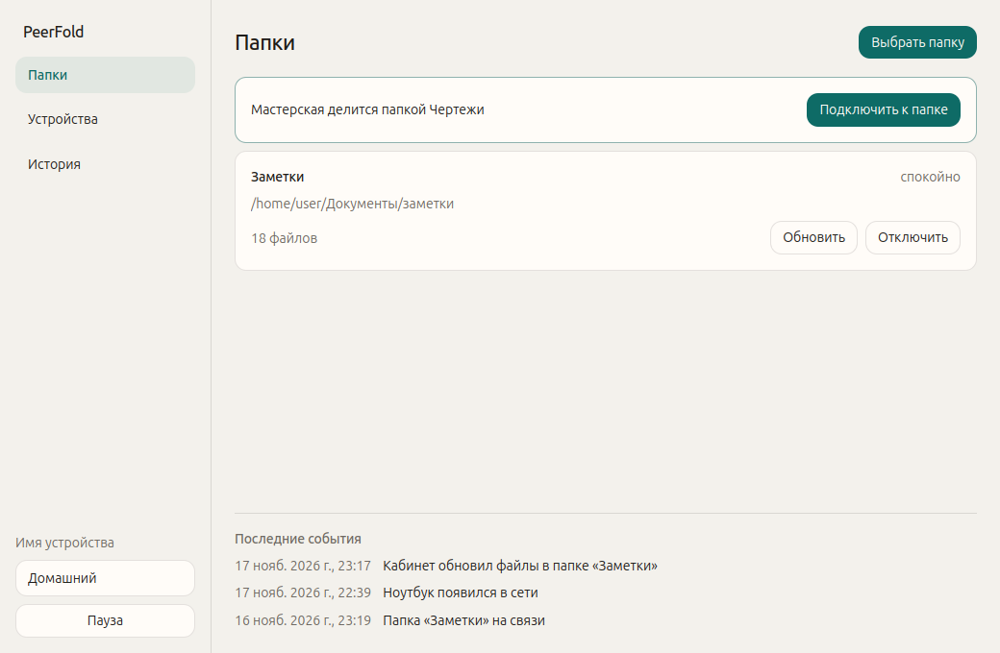
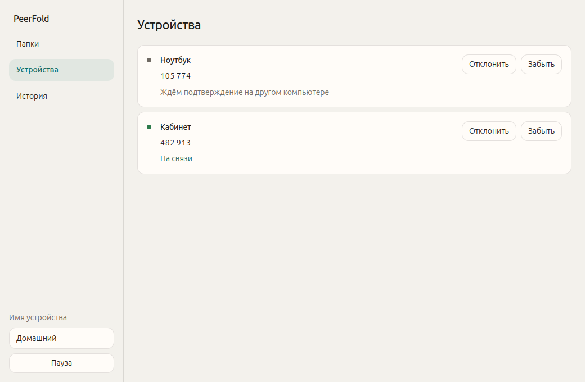
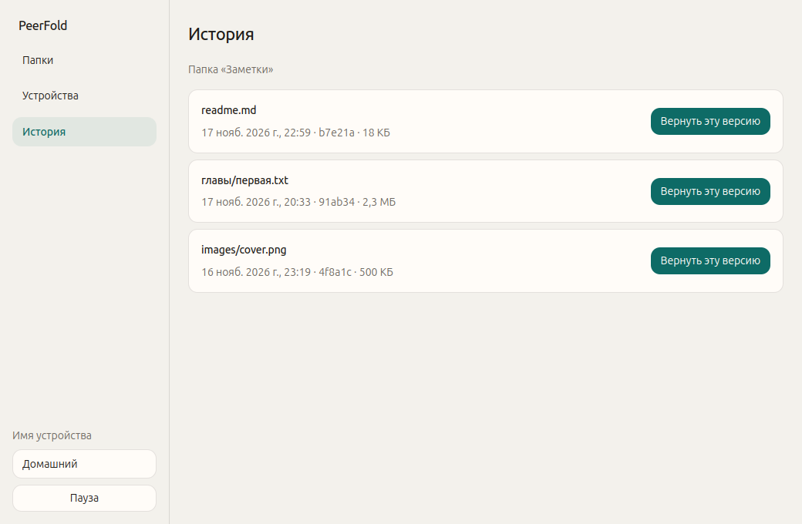

# PeerFold

PeerFold синхронизирует папки между вашими компьютерами в одной домашней сети. Можно вечером поработать на ноутбуке, а утром открыть ту же папку на другом компьютере: файлы уже будут там.

Это нужно, когда разработка идёт с ИИ-агентами сразу на нескольких машинах. У одного компьютера Windows, у другого Linux, иногда появляется третий. Облако для этого лишнее: компьютеры и так стоят дома в одном Wi‑Fi.



## Какую задачу решает

Агент поправил проект на ноутбуке. Настольный компьютер об этом не знает, пока папку не перенести вручную. PeerFold держит выбранные папки одинаковыми на всех своих компьютерах в локальной сети.

- Компьютеры сами находят друг друга.
- Каждое устройство один раз подтверждают кодом.
- Все компьютеры равны: нет главного и нет сервера.
- Если оба успели изменить один файл, побеждает более новая запись, а прежняя копия остаётся рядом и в истории.

## Как это работает

1. Ставите PeerFold на каждый компьютер и запускаете. Окно можно закрыть: программа остаётся в трее и продолжает синхронизацию.
2. В разделе «Устройства» появляется сосед по сети. На одном компьютере нажимаете «Доверять», на другом сверяете шестизначный код и подтверждаете.
3. На любом компьютере выбираете папку проекта. Она получает общий идентификатор.
4. На остальных компьютерах эта папка появляется как предложение. Нажимаете «Подключить к папке» и указываете локальный каталог. Дальше файлы сходятся сами.



Компьютеры объявляют себя по mDNS и говорят по TCP только с теми, кому вы доверяете. Каждое сообщение подписано ключом устройства. По локальной сети содержимое не шифруется: сеть считается домашней, а подпись не даёт подменить компьютер.

Актуальная версия файла выбирается по времени изменения. Если оба компьютера изменили файл после последней общей версии, более новый становится основным, а второй сохраняется как `имя.conflict-устройство-время.ext`. Отдельно хранится история: до 20 версий каждого файла. Её можно вернуть из раздела «История», и эта версия снова разойдётся по остальным компьютерам.



Симлинки не синхронизируются, чтобы ссылка не вывела запись за пределы папки. Недописанный временный файл передачи тоже не уходит соседям. Обычное содержимое, включая `node_modules` и `.git`, синхронизируется целиком. Фильтр `.syncignore` заложен в коде как отдельная проверка и пока всегда пропускает файлы.

Часы на компьютерах должны быть примерно верными: при расхождении побеждает то время, которое стоит на файле.

## Сборки

Готовые версии для Windows и Linux публикуются в [релизах](https://github.com/BrazhnikDA/peerfold/releases).

- Windows 10 и новее: установщик `.msi` или `.exe`.
- Linux с WebKitGTK 4.1 (Ubuntu 22.04 и новее, Debian 12): `.deb` или `.AppImage`.

На Linux для работы из пакета нужны библиотеки, которые указывает сам пакет. Если собираете из исходников на Debian или Ubuntu:

```bash
sudo apt update
sudo apt install libwebkit2gtk-4.1-dev build-essential curl wget file libxdo-dev libssl-dev libayatana-appindicator3-dev librsvg2-dev
```

Дальше:

```bash
npm install
npm run tauri dev
```

Сборка установщика:

```bash
npm run tauri build
```

Нужны Node.js и Rust stable. Приложение собрано на Tauri 2: окно — системный WebView, синхронизация — отдельное Rust-ядро. В простое это один лёгкий процесс, без Electron и без облака.
